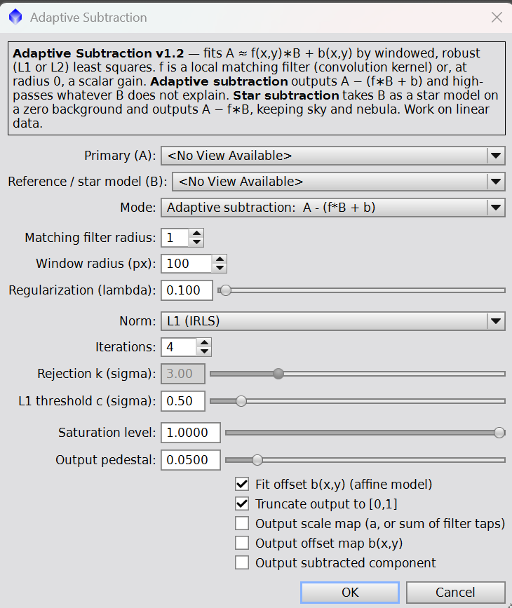

# AdaptiveSubtraction for PixInsight

Removes an unwanted signal from an astronomical image by subtracting a **reference image** or **model** of it,
after matching that model to the image locally.

Many artefacts can be modelled by a separate tool: stars rendered from a catalog, a satellite trail, diffraction
spikes, a gradient, camera banding. No model is exact, though. Brightness changes along a trail, a catalog flux is not
the flux through your filter, a rendered PSF is slightly too narrow, a background model misses a term. Subtract such a
model directly and its errors stay in the image.

AdaptiveSubtraction takes the primary image **A** and the reference or model **B** and fits, in every window, a small
convolution kernel *f* (or a scalar gain) and an offset *b* by robust least squares:

```
A(x,y) ≈ (f ⋆ B)(x,y) + b(x,y)
```

The kernel absorbs errors in amplitude, profile width and sub-pixel position that vary slowly across the field.

Version 1.2 · Author: Erellaz · License: MIT



## Installation

AdaptiveSubtraction is installed with the rest of this package: it appears as **Script › BlackRig ›
AdaptiveSubtraction**. Run on its own, copy `AdaptiveSubtraction.js` into a scripts folder, then in PixInsight
**Script › Feature Scripts… › Add**, select the folder, **Done**.

It is an interactive script: it works on two images open in PixInsight. It has no batch mode and no WBPP step.

## Inputs

- **Primary (A):** the image to clean. Linear, monochrome.
- **Reference / star model (B):** the signal to remove, alone. Same dimensions as A and registered to it.

Pixels where A is 0 (registration borders) are left out of the fit and set to 0 in the output.

## Modes

| Mode | Output | Use it when |
|---|---|---|
| **Adaptive subtraction** (default) | A − (f⋆B + b) | B predicts part of A and the rest may be high-passed: everything B explains and the local offset are removed, so whatever B does not explain keeps only scales below about twice the window radius. Pixels where B is 0 are treated as missing. |
| **Star subtraction** | A − f⋆B | B is a star model (or any model) on a zero background. The offset b is fitted only so that it does not bias the kernel, and is not subtracted: sky and nebula are kept. B = 0 is valid here. |

## Parameters

| Dialog control | Default | Effect |
|---|---|---|
| Matching filter radius | 1 | 0: a local scalar gain, no kernel. 1 to 3: a local 3×3 to 7×7 matching filter, which absorbs PSF width and shape mismatch and sub-pixel shifts. |
| Window radius (px) | 100 | Half-size of the fitting window (window about 2r+1 pixels). Smaller follows faster variations of the mismatch but fits more noise. |
| Regularization (lambda) | 0.100 | Ridge regularization toward the global fit, for windows with little model signal. |
| Norm | L1 (IRLS) | L2 (one plain least-squares fit), L2 with k-sigma rejection, or L1 by iteratively reweighted least squares. The robust norms keep stars and other signal that B does not describe from biasing the fit. |
| Iterations | 4 | Number of fits for the robust norms (L2 always uses one). |
| Rejection k (sigma) | 3.00 | L2 with rejection: residuals beyond k × 1.4826 × MAD are left out of the next fit. |
| L1 threshold c (sigma) | 0.50 | L1: quadratic within c × sigma of the fit, L1 beyond. |
| Saturation level | 1.0000 | Pixels of A at or above this level are left out of the fit (not the output). 1 turns it off. |
| Output pedestal | 0.0500 | Added to the output in adaptive subtraction mode, to keep it above 0. |
| Fit offset b(x,y) (affine model) | on | Fits the local offset b. Off: A ≈ f⋆B. |
| Truncate output to [0,1] | on | Clips the output. The console reports how many pixels were clipped. |
| Output scale map | off | Also outputs the local gain a(x,y), or the sum of the filter taps. |
| Output offset map b(x,y) | off | Also outputs the fitted offset. |
| Output subtracted component | off | Also outputs what was subtracted. |

## Outputs

New image windows named after A:

- `<A>_adaptsub` (adaptive subtraction) or `<A>_starless` (star subtraction): the result.
- `<A>_scale`, `<A>_offset`: the scale and offset maps, if selected.
- `<A>_prediction` (adaptive subtraction) or `<A>_stars` (star subtraction): the subtracted component, if selected.

In star subtraction mode, pixels clipped below 0 mean over-subtraction. In adaptive subtraction mode, raise the
pedestal if the console reports more than a few pixels below 0.

## Memory

About 40 bytes per pixel with a scalar gain, 30 bytes per pixel with a matching filter.

## Documentation

`AdaptiveSubtraction_how_it_works.docx` is the user guide and technical description: quick start, recommended
settings per use case (stars, trails, diffraction spikes, banding, gradients), the method with its equations, the
parameters, validation and limitations. Its numbers and figures come from the test suite
`tests/test_adaptivesubtraction.js` (17 checks, synthetic images), run on this version.

## Author and license

Erellaz. MIT license: see `LICENSE.txt`.
